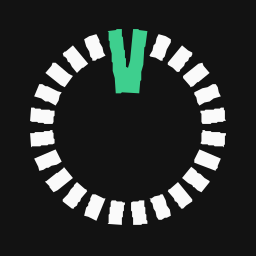

# Pay24.now — Logo Kit

[](https://github.com/pay24-dev/logo-kits/tree/development) [](assets/CATALOG.md)

A public, organized asset library for **Pay24.now** logos, wordmarks, app icons and favicons. Files are available directly through GitHub and its raw content host, or via **jsDelivr CDN**. No package manager, build process or API key is required to consume the files.



> **Visual provenance:** `v2` is the newer traced-logo collection using custom outlined lettering; `v1` preserves earlier artwork. The exact original typeface cannot be established. A selected typography screenshot described by prior documentation is not present in this repository. These assets are not a representation of trademark clearance or independent production/accessibility approval.

## Quick start

**Recommended primary logo for a dark background** (SVG):

| Access method | Direct link |
| --- | --- |
| GitHub file page | [View SVG](https://github.com/pay24-dev/logo-kits/blob/development/assets/v2/svg/pay24-horizontal-on-dark.svg) |
| GitHub raw/direct | [Download SVG](https://raw.githubusercontent.com/pay24-dev/logo-kits/development/assets/v2/svg/pay24-horizontal-on-dark.svg) |
| jsDelivr CDN | [Serve SVG](https://cdn.jsdelivr.net/gh/pay24-dev/logo-kits@development/assets/v2/svg/pay24-horizontal-on-dark.svg) |

**Copy into HTML** (use the on-light variant when the surrounding surface is light):

```html

```

**CSS background image:**

```css
.pay24-logo {
  width: 220px;
  height: 60px;
  background: url("https://cdn.jsdelivr.net/gh/pay24-dev/logo-kits@development/assets/v2/svg/pay24-horizontal-on-light.svg")
    center / contain no-repeat;
}
```

## Recommended assets

All links below target the **development** branch and describe actual tracked files.

| Purpose | GitHub | Raw file | jsDelivr |
| --- | --- | --- | --- |
| Horizontal / dark surface SVG | [View](https://github.com/pay24-dev/logo-kits/blob/development/assets/v2/svg/pay24-horizontal-on-dark.svg) | [Direct](https://raw.githubusercontent.com/pay24-dev/logo-kits/development/assets/v2/svg/pay24-horizontal-on-dark.svg) | [CDN](https://cdn.jsdelivr.net/gh/pay24-dev/logo-kits@development/assets/v2/svg/pay24-horizontal-on-dark.svg) |
| Horizontal / light surface SVG | [View](https://github.com/pay24-dev/logo-kits/blob/development/assets/v2/svg/pay24-horizontal-on-light.svg) | [Direct](https://raw.githubusercontent.com/pay24-dev/logo-kits/development/assets/v2/svg/pay24-horizontal-on-light.svg) | [CDN](https://cdn.jsdelivr.net/gh/pay24-dev/logo-kits@development/assets/v2/svg/pay24-horizontal-on-light.svg) |
| Stacked / dark surface SVG | [View](https://github.com/pay24-dev/logo-kits/blob/development/assets/v2/svg/pay24-stacked-on-dark.svg) | [Direct](https://raw.githubusercontent.com/pay24-dev/logo-kits/development/assets/v2/svg/pay24-stacked-on-dark.svg) | [CDN](https://cdn.jsdelivr.net/gh/pay24-dev/logo-kits@development/assets/v2/svg/pay24-stacked-on-dark.svg) |
| Standalone wordmark SVG | [View](https://github.com/pay24-dev/logo-kits/blob/development/assets/v2/svg/pay24-wordmark-on-dark.svg) | [Direct](https://raw.githubusercontent.com/pay24-dev/logo-kits/development/assets/v2/svg/pay24-wordmark-on-dark.svg) | [CDN](https://cdn.jsdelivr.net/gh/pay24-dev/logo-kits@development/assets/v2/svg/pay24-wordmark-on-dark.svg) |
| Logo symbol SVG | [View](https://github.com/pay24-dev/logo-kits/blob/development/assets/v2/svg/pay24-mark-master.svg) | [Direct](https://raw.githubusercontent.com/pay24-dev/logo-kits/development/assets/v2/svg/pay24-mark-master.svg) | [CDN](https://cdn.jsdelivr.net/gh/pay24-dev/logo-kits@development/assets/v2/svg/pay24-mark-master.svg) |
| Application icon SVG | [View](https://github.com/pay24-dev/logo-kits/blob/development/assets/v2/svg/pay24-app-icon.svg) | [Direct](https://raw.githubusercontent.com/pay24-dev/logo-kits/development/assets/v2/svg/pay24-app-icon.svg) | [CDN](https://cdn.jsdelivr.net/gh/pay24-dev/logo-kits@development/assets/v2/svg/pay24-app-icon.svg) |
| Horizontal / dark 1200px PNG | [View](https://github.com/pay24-dev/logo-kits/blob/development/assets/v2/png/pay24-horizontal-on-dark-1200w.png) | [Direct](https://raw.githubusercontent.com/pay24-dev/logo-kits/development/assets/v2/png/pay24-horizontal-on-dark-1200w.png) | [CDN](https://cdn.jsdelivr.net/gh/pay24-dev/logo-kits@development/assets/v2/png/pay24-horizontal-on-dark-1200w.png) |
| Horizontal / dark 1200px WebP | [View](https://github.com/pay24-dev/logo-kits/blob/development/assets/v2/webp/pay24-horizontal-on-dark-1200w.webp) | [Direct](https://raw.githubusercontent.com/pay24-dev/logo-kits/development/assets/v2/webp/pay24-horizontal-on-dark-1200w.webp) | [CDN](https://cdn.jsdelivr.net/gh/pay24-dev/logo-kits@development/assets/v2/webp/pay24-horizontal-on-dark-1200w.webp) |
| Favicon SVG | [View](https://github.com/pay24-dev/logo-kits/blob/development/assets/v2/favicon/favicon.svg) | [Direct](https://raw.githubusercontent.com/pay24-dev/logo-kits/development/assets/v2/favicon/favicon.svg) | [CDN](https://cdn.jsdelivr.net/gh/pay24-dev/logo-kits@development/assets/v2/favicon/favicon.svg) |
| Favicon ICO | [View](https://github.com/pay24-dev/logo-kits/blob/development/assets/v2/favicon/favicon.ico) | [Direct](https://raw.githubusercontent.com/pay24-dev/logo-kits/development/assets/v2/favicon/favicon.ico) | [CDN](https://cdn.jsdelivr.net/gh/pay24-dev/logo-kits@development/assets/v2/favicon/favicon.ico) |

For **every available file**, use the [complete asset catalog](assets/CATALOG.md) with individually linked GitHub, Raw and CDN locations, or the [machine-readable inventory](assets/manifest.json).

## Directory structure

```text
assets/
  v2/                 Newer custom-lettering set (recommended where available)
    svg/               Vector logo artwork
    png/               Size-specific raster exports
    webp/              Web-optimized raster exports
    favicon/           Multi-size favicon and ICO
  v1/                 Earlier asset generation, preserved without alteration
    svg/
    png/
    webp/
    favicon/
  previews/            Review boards (not canonical logo masters)
  reference/           Supplied source image and generated concept images
    concepts/
  CATALOG.md           Exhaustive clickable index
  manifest.json        Machine-readable file paths, byte sizes, Git blob IDs and old paths
docs/
  LOGO-SPEC.md         Brand geometry, colors and usage notes
  TYPOGRAPHY.md        Outlined lettering provenance
  COLORS.json          Logo-only color palette
  archive/             Original manifests and superseded documentation
```

## URL patterns

For an exact tracked relative path (for example `assets/v2/svg/pay24-horizontal-on-dark.svg`):

```text
GitHub browser: https://github.com/pay24-dev/logo-kits/blob/development/<path>
GitHub raw:     https://raw.githubusercontent.com/pay24-dev/logo-kits/development/<path>
jsDelivr:       https://cdn.jsdelivr.net/gh/pay24-dev/logo-kits@development/<path>
```

The branch name `development` is **mutable**. For production, replace `@development` in jsDelivr URLs with a release tag or **full commit SHA**, and replace `/development/` in raw URLs with the same tag or SHA. Pinned URLs avoid changes when a branch is updated; branch-backed CDN content may be cached and is not an instant-deployment mechanism. This branch has not been merged to `main`.

## Selection, formats and accessibility

- Choose `on-dark` for dark backgrounds and `on-light` for light backgrounds; filenames describe the intended **surface**, not the logo's own backdrop.
- Prefer vector SVG for layout/headers; use PNG when raster transparency or broad compatibility is required, and WebP for optimized web images.
- Use `favicon.svg`, `favicon.ico` or sized favicon PNGs for the browser tab/app icon. Not every `v2` SVG has corresponding raster exports; inspect the catalog rather than guessing a file path.
- Preserve proportions and letterforms, particularly the forked green accent and the `Pay24.now` spelling. Provide an accessible text name when the logo is informative; avoid duplicating adjacent brand labels in screen-reader output.
- Colors: charcoal `#121212`, near-white `#FAFAFA`, emerald `#3ECF8E`. The green accent is **not** an indicator of payment success.
- Browser-specific rendering and small-size legibility checks, trademark review and usage rights are independent of this file organization.

## Asset maintenance

Filenames use **lowercase kebab-case** with explicit purpose, surface, width (such as `1200w`) and file extension. The migration kept all original binary content by reusing original Git blob objects; `source_path` in `assets/manifest.json` records the prior location. Avoid mixing `v1` and `v2` artwork within one branded composition without a design review.

See [asset catalog](assets/CATALOG.md), [logo specification](docs/LOGO-SPEC.md), [typography notes](docs/TYPOGRAPHY.md), [palette](docs/COLORS.json) and [change history](CHANGELOG.md).

## Licensing

The repository holds Pay24.now brand artwork. **No general open-source license or trademark-use grant is implied by public access.** Obtain permission from the relevant rights holder for uses requiring authorization.
